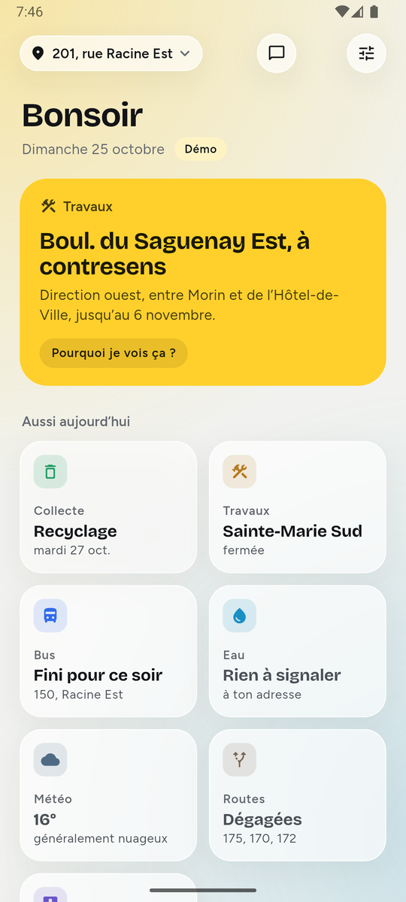
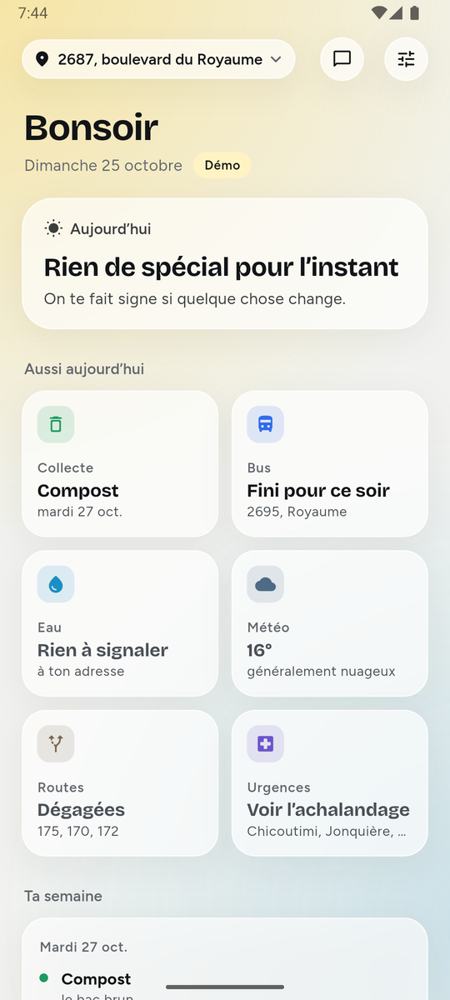
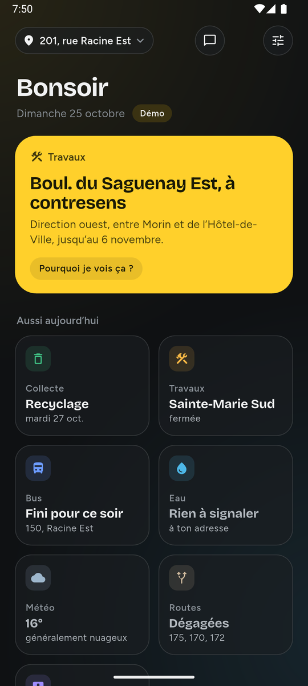
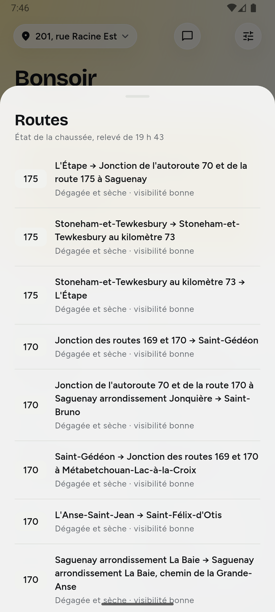
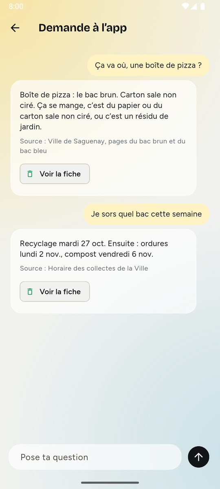
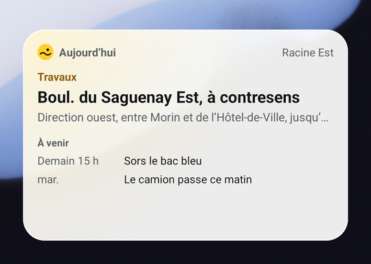

# Saguenay Aujourd'hui

[](https://github.com/gotflo/saguenay_aujourdhui/actions/workflows/tests.yml)
[](https://github.com/gotflo/saguenay_aujourdhui/actions/workflows/apple.yml)

Une petite app qui te dit ce qui compte aujourd'hui à Saguenay : le bac à sortir, la rue où tu ne
peux pas te garer cette nuit, l'avis d'ébullition dans ton secteur, la neige annoncée, la coupure
de courant de demain, le prochain bus. Le plus souvent, on n'a même pas besoin de l'ouvrir : le
widget d'écran d'accueil suffit.

<table>
  <tr>
    <td align="center"><br><sub>Ce qui compte, en premier</sub></td>
    <td align="center"><br><sub>Une vraie adresse, en direct</sub></td>
    <td align="center"><br><sub>En mode sombre</sub></td>
  </tr>
  <tr>
    <td align="center"><br><sub>Une fiche de détail</sub></td>
    <td align="center"><br><sub>Demande à l'app</sub></td>
    <td align="center"><br><sub>Le widget, qui change tout seul</sub></td>
  </tr>
</table>

<sub>Captures faites sur un émulateur Android, version de production, le 25 octobre 2026.</sub>

## Pourquoi

Toutes ces infos existent déjà, mais elles sont éparpillées entre une douzaine de sources : le site
de la Ville, la carte des avis d'aqueduc, la carte de circulation, la STS, le ministère de la Santé,
Environnement Canada, Hydro-Québec, Québec 511, les stations de qualité de l'air, les interdictions
de feux. Un dimanche soir de novembre, pour savoir si on
sort le bac, si on peut laisser l'auto dans la rue et si l'avis d'ébullition est levé, il faut
tout fouiller. L'app lit ces sources pour une adresse et met en premier ce qui compte à l'heure
qu'il est.

C'est un projet indépendant. Il n'est pas affilié à la Ville de Saguenay ni à la STS.

## Ce que fait l'app

- **N'importe quelle adresse de Saguenay.** La recherche passe par le géocodeur du gouvernement
  du Québec, puis par la couche d'adresses de la Ville. On peut en garder plusieurs.
- **Une seule carte en haut**, la plus importante à l'heure qu'il est, et des tuiles pour le reste.
- **La semaine qui vient**, calculée sur le téléphone, et un résumé chaque dimanche à 18 h.
- **Un widget en temps réel** sur Android et iOS, qui connaît d'avance les sept prochains jours.
- **Des alertes même app fermée** (avis d'eau, avertissements météo) et des rappels qui sonnent
  sans réseau. Des heures calmes la nuit, sauf pour un avis d'ébullition.
- **Demande à l'app** : des réponses tirées des données de l'adresse, sans réseau (« Ça va où,
  une boîte de pizza ? », « Je sors quel bac cette semaine ? »). En ligne, une photo suffit pour
  le tri, et les communiqués de la Ville sont résumés en mots simples.
- **Veiller sur un proche.** Chaque adresse gardée peut porter un nom (« Chez maman », « Chalet »).
  Un avis d'eau ou une panne y est signalé sous ce nom, sans qu'il faille l'afficher.
- **Partager une adresse** par texto ou messagerie : le lien l'ajoute chez l'autre, sans compte,
  après confirmation. Le nom reste chez soi.
- **L'air, les feux et les pointes, seulement quand ça compte** : l'air mauvais à la station la plus
  proche, une interdiction de feux qui couvre l'adresse, une pointe d'Hydro-Québec la veille (au
  choix, pour le Crédit hivernal ou Flex D). Le reste du temps, rien ne s'affiche.
- **Des cartes en direct** des zones d'avis d'eau et des chantiers autour de l'adresse, et la neige
  ou la pluie qui tombe sur la carte du haut quand il en tombe vraiment.
- **Sans téléphone intelligent** : on texte son adresse (ou on la dit au téléphone) et on reçoit la
  journée en quelques phrases.
- **Signaler un problème à la Ville** : un message clair à coller dans le formulaire officiel.
- **Tes collectes dans ton calendrier**, en un fichier iCal.

## Les sources

Toutes sont branchées et lues en direct.

| Information | Source | Publication |
|---|---|---|
| Collectes | Calendrier de la Ville, pour l'adresse (le même formulaire que sur son site) | Accord de la Ville demandé |
| Avis d'aqueduc | Carte des avis de la Ville (ArcGIS), zone par zone | Accord de la Ville demandé |
| Bus | Horaire GTFS et retards GTFS-RT de la STS | Licence de la STS demandée |
| Stationnement de nuit | Règlement VS-R-2006-44, art. 9.21 | Prêt |
| Travaux | Carte de circulation de la Ville (ArcGIS) | Prêt |
| Urgences | Ministère de la Santé, relevé horaire (CC BY 4.0) | Prêt |
| Météo et alertes | Environnement Canada, API GeoMet (Licence du gouvernement ouvert) | Prêt |
| Pannes et coupures planifiées | Hydro-Québec (CC BY-NC 4.0) | Prêt, licence non commerciale |
| Routes et caméras | Ministère des Transports, Québec 511 (CC BY 4.0) | Prêt |
| Qualité de l'air | Ministère de l'Environnement, IQA horaire des stations Parc Powell et UQAC (CC BY 4.0) | Prêt |
| Interdictions de feux | Ministère de la Sécurité intérieure et SOPFEU, zones en vigueur (WFS) | Prêt |
| Pointes de consommation | Hydro-Québec, événements de pointe résidentiels (CC BY-NC 4.0) | Prêt, licence non commerciale |
| Fond des cartes | OpenStreetMap (ODbL) | Prêt pour un essai ; un fournisseur de tuiles pour la sortie publique |

Pas encore possible : savoir quand la déneigeuse passe dans ta rue (rien n'est public).

Quelques pièges que le code gère : les couches ArcGIS de la Ville enregistrent l'heure locale comme
si c'était de l'UTC ; la carte des avis laisse « Actif » des avis terminés, on se fie donc à la date
de fin ; le flux de la STS n'a que des dates d'exception, pas de calendrier hebdomadaire.

L'app lit les pages publiques de la Ville comme le ferait un navigateur : aucun cookie, aucun
jeton, une lecture par semaine et par adresse pour les collectes.

## Comment l'app choisit quoi montrer

Chaque information a un poids, son importance en soi, et une urgence, à quel point c'est le moment.
Le score est le produit des deux. La plus haute prend la grande carte du haut si elle dépasse 15.

- Un avis d'ébullition à l'adresse vaut toujours 100. Rien ne passe devant.
- Un avertissement d'Environnement Canada vaut 85, une panne dans le secteur 75.
- Le stationnement de nuit monte à mesure que minuit approche : 50 à 17 h, 90 à 21 h.
- La veille de la collecte, le rappel du bac monte à partir de 15 h.
- Le bus prend de l'importance aux heures de pointe, si l'arrêt a un départ bientôt.
- Une route fermée ou glacée sur la 175, la 170 ou la 172 passe en haut ; sinon, une tuile calme.
- L'air, les feux et les pointes ne comptent que s'ils touchent l'adresse : un air mauvais, une
  interdiction sur son secteur, une pointe dans les 36 heures. Un air bon ne prend aucune place.
- La carte des urgences ne monte jamais d'elle-même : on ne veut pas pousser quelqu'un à choisir un
  hôpital d'après des chiffres.

Tout est dans [`relevance.dart`](packages/saguenay_core/lib/src/relevance.dart), et chaque cas a
son test.

## Le widget

Le widget est du code natif : il ne fait pas tourner le moteur Dart. L'app calcule d'avance la
suite des sept prochains jours, une entrée par changement, à la minute près (le bus de 7 h 46
disparaît à 7 h 47), et le widget affiche la bonne au bon moment.

- Les textes donnent des heures, jamais « dans 16 min » : ils restent vrais.
- Android : redessiné à chaque changement, recalé quand l'heure ou le fuseau change, après un
  redémarrage et après une mise à jour. Trois tailles.
- iOS : une timeline WidgetKit avec les mêmes données, partagées par un groupe d'apps. Petit,
  moyen, grand, et l'écran verrouillé.
- Un toucher ouvre la fiche de ce qui est affiché. Passé sept jours sans ouvrir l'app, il demande
  de l'ouvrir plutôt que d'afficher du périmé.

## Notifications et tâche de fond

- **Rappels prévisibles**, programmés pour quatre semaines : le stationnement à 21 h les soirs
  d'hiver, le bac la veille à 19 h, les travaux sur ta rue à 6 h 45, les coupures planifiées la
  veille, « Ta semaine » le dimanche à 18 h.
- **Une relecture toutes les heures, app fermée** (WorkManager sur Android, BGTaskScheduler sur
  iOS) : elle relit les sources, envoie un nouvel avis d'eau, une alerte météo, l'air mauvais, une
  panne ou une pointe (au choix), redessine le widget et prolonge les rappels.
- **Les autres adresses gardées** sont surveillées aussi : leurs avis d'eau et leurs pannes arrivent
  sous leur nom, « Chez maman : avis d'ébullition ». Aucun serveur de notifications : c'est le téléphone
  qui fait le travail. Vérifié sur Android en version de production.
- **Heures calmes**, de 22 h à 7 h, au choix : les alertes qui ne pressent pas attendent le matin.
- Toucher une notification ouvre directement la bonne fiche.

## L'assistant

Les réponses courantes sont calculées sur le téléphone, sans réseau, d'après les données de
l'adresse et les pages de tri de la Ville. Pour le reste, un petit serveur
([`server/`](server/README.md)) prend le relais avec Claude : questions libres, tri en photo,
textes officiels en langage simple, communiqués de la Ville résumés à partir de leur PDF. Il répond
dans la langue de la question et nomme sa source ; sans l'information, il le dit au lieu de
deviner. La clé d'API reste sur le serveur ; l'app n'envoie que le secteur, jamais l'adresse.

## Sans téléphone intelligent

Le même serveur répond par texto et au téléphone (format TwiML de Twilio) : on écrit
« 201 rue Racine Est », ou on le dit, et on reçoit la journée de l'adresse en 320 caractères au
plus : l'eau, le stationnement, la prochaine collecte, une panne. Les relevés de la ville sont
gardés dix minutes pour tout le monde ; ni le numéro ni l'adresse ne sont conservés. Les heures
sont celles de Saguenay, quel que soit l'hébergeur (`TZ=America/Toronto` dans l'image Docker).

## La version web

La même app Flutter tourne dans un navigateur. Météo, avis d'eau, travaux, routes et recherche
d'adresse marchent directement. Le site de la Ville (collectes), le ministère de la Santé et
Hydro-Québec n'autorisent pas les navigateurs : le serveur les relaie, sur une liste fermée
d'adresses, avec un cache court. Sans serveur, l'app web le dit au lieu d'afficher une fausse date.

## Sans réseau

| Marche sans réseau | A besoin du réseau |
|---|---|
| Stationnement, collectes de l'adresse, trois semaines d'horaire du bus | Météo et alertes |
| Avis et coupures déjà connus | Pannes, routes et urgences |
| Le widget, pour sept jours | Retards du bus |
| Les rappels et les réponses de l'app | L'assistant en ligne |

Sans réseau, l'app garde le dernier relevé de chaque source, le montre avec son heure et affiche
une petite pastille « Hors ligne ».

## Le design

Jaune déneigeuse et noir, en verre dépoli : les cartes laissent deviner deux halos doux, un liseré
clair les détache du fond, et la carte du haut reste pleine quand quelque chose presse. Un thème
« Ville de Saguenay » reprend le bleu du site de la Ville ; on ne l'utilisera en public qu'avec son
accord. Les contrastes sont vérifiés par des tests (4,5:1 au minimum, sur le halo le plus fort), en
clair et en sombre, avec le texte agrandi jusqu'à ×2.

## Sécurité et vie privée

- L'adresse reste sur le téléphone : pas de compte, pas de sauvegarde dans le nuage.
- Toutes les connexions sont en HTTPS. Chaque téléchargement a un délai et une taille maximale ; un
  fichier abîmé ne remplace jamais le dernier bon relevé.
- Le serveur de l'assistant borne chaque demande, plafonne les appels par appareil et par jour, et
  ne garde aucune question ni photo.
- Les manifestes de confidentialité iOS déclarent zéro suivi et zéro donnée collectée.
- Les clés de signature (Android et iOS) ne vivent pas dans le dépôt.

## Dans le dépôt

| Dossier | Contenu |
|---|---|
| [`app/`](app/) | L'app Flutter (Android, iOS, web), ses widgets natifs et sa tâche de fond |
| [`packages/saguenay_core/`](packages/saguenay_core/) | Les règles, le moteur qui décide quoi afficher et les lecteurs de chaque source. Dart pur. |
| [`server/`](server/) | Le serveur de l'assistant et le relais de la version web |
| [`prototype/`](prototype/) | La page de démo montrée aux partenaires |
| [`docs/`](docs/) | Notes techniques et captures |
| `Saguenay-Aujourdhui.pptx` | La présentation aux partenaires |

## Lancer

L'app (Flutter 3.38) :

```bash
cd app
flutter run
```

Avec l'assistant en ligne et le relais web, après avoir lancé le serveur :

```bash
flutter run -d chrome --dart-define=ASSISTANT_URL=https://assistant.exemple.ca/
```

Le serveur :

```bash
cd server
ANTHROPIC_API_KEY=... dart run bin/server.dart
```

Sur iOS, il faut un Mac et un compte développeur Apple pour signer : la cible du widget, le groupe
d'apps, la tâche de fond et les droits sont déjà configurés dans le projet. Voir
[`docs/widget-ios.md`](docs/widget-ios.md).

## Tests

```bash
cd packages/saguenay_core && dart test
cd server && dart test
cd app && flutter test
```

337 tests : les règles et le moteur, la suite du widget (minute exacte, nuit du changement d'heure,
temps de calcul), les lecteurs de chaque source sur leurs vraies réponses enregistrées, y compris
abîmées, trop grosses ou trop lentes ; les parcours de l'app, les notifications, la tâche de fond,
l'affichage sur quatre tailles d'écran, les adresses suivies et partagées ; la configuration Android
et iOS que seule la version de production révèle ; le serveur, son relais, le texto et la voix.

À chaque envoi sur GitHub, une machine Linux lance tous les tests et compile la version web, et
une machine macOS compile l'app iOS avec son widget.

## Ce qui reste à faire

- Les accords de la Ville et de la STS avant la sortie publique.
- Les clés de signature, puis la publication sur le Play Store et l'App Store.
- Un essai sur un vrai iPhone (le projet iOS est compilé par la machine macOS, mais pas encore
  installé sur un appareil).
- Une clé d'API pour le serveur de l'assistant, et son hébergement.
